# nuLigaHelper Benutzerhandbuch

## Heimspieltage gemeinsam organisieren

Mit nuLigaHelper siehst du die Heimspiele der Handballabteilung des TuS Raubling und die dazugehörigen Helferdienste. Du kannst freie Dienste übernehmen, bei Bedarf rechtzeitig Ersatz suchen und deine hinterlegten Daten pflegen. Mannschaftsverantwortliche und Admins erhalten zusätzliche Funktionen für die Organisation.

Diese Anleitung führt dich Schritt für Schritt durch die Weboberfläche. Du brauchst keine technischen Vorkenntnisse und musst keine Software installieren. Ein Browser auf deinem Smartphone, Tablet oder Computer genügt. Die Adresse des Webservice erhältst du von der Vereinsorganisation. Je nach Einrichtung brauchst du Zugang zum Vereinsnetz oder zum dafür vorgesehenen Fernzugang.

**Die wichtigste Regel:** Eine bestätigte Einteilung ist verbindlich. Wenn du Ersatz suchst, bleibst du verantwortlich, bis eine geeignete Person den Dienst im System übernommen hat. Am Vortag des Dienstes um **09:00 Uhr deutscher Ortszeit** werden besetzte Dienste fest. Danach ist ein Wechsel im Webservice auch für Admins geschlossen.

Die Anleitung beschreibt die Weboberfläche von Version 0.30 mit Stand vom 25. Oktober 2026. Die Saisonanzeige 2026/27 meint den Zeitraum Juli 2026 bis Juni 2027. Abbildungen zeigen Beispielsituationen; die orangefarbenen Nummern verweisen auf die Erläuterungen unmittelbar darunter. Je nach Bildschirmgröße stehen Bedienelemente untereinander statt nebeneinander. Die gezeigten Geburtsdatumsfelder können aufgrund der Browsereinstellungen ein anderes Datumsformat anzeigen als auf deinem Gerät.

**So findest du deinen Einstieg:** Als neue Helferin oder neuer Helfer beginnst du mit den Kapiteln 1 bis 4. Für eine Dienstübernahme sind die Kapitel 5 bis 10 wichtig. Mannschaftsverantwortliche lesen zusätzlich Kapitel 15, Admins die Kapitel 16 bis 19. Bei Schwierigkeiten hilft Kapitel 21.

## Inhalt

- [1 Dein erster Dienst in wenigen Schritten](#1-dein-erster-dienst-in-wenigen-schritten)
- [2 Welche Rechte du hast](#2-welche-rechte-du-hast)
- [3 Zum ersten Mal registrieren](#3-zum-ersten-mal-registrieren)
- [4 Anmelden und abmelden](#4-anmelden-und-abmelden)
- [5 Den Heimspielplan verstehen](#5-den-heimspielplan-verstehen)
- [6 Spiele und eigene Dienste finden](#6-spiele-und-eigene-dienste-finden)
- [7 Welche Aufgaben es gibt](#7-welche-aufgaben-es-gibt)
- [8 Altersvoraussetzungen verstehen](#8-altersvoraussetzungen-verstehen)
- [9 Einen freien Dienst verbindlich übernehmen](#9-einen-freien-dienst-verbindlich-übernehmen)
- [10 Ersatz suchen und einen Dienst übernehmen](#10-ersatz-suchen-und-einen-dienst-übernehmen)
- [11 Vorbereitung und Aufräumen übernehmen](#11-vorbereitung-und-aufräumen-übernehmen)
- [12 Einen Kuchen zusagen und Kuchen planen](#12-einen-kuchen-zusagen-und-kuchen-planen)
- [13 Eigene Daten pflegen](#13-eigene-daten-pflegen)
- [14 Die Statistik lesen](#14-die-statistik-lesen)
- [15 Als Mannschaftsverantwortlicher organisieren](#15-als-mannschaftsverantwortlicher-organisieren)
- [16 Als Admin Benutzer verwalten](#16-als-admin-benutzer-verwalten)
- [17 Als Admin Mannschaften und Dienste organisieren](#17-als-admin-mannschaften-und-dienste-organisieren)
- [18 Als Admin Spieltage ausblenden](#18-als-admin-spieltage-ausblenden)
- [19 Das Änderungsprotokoll verwenden](#19-das-änderungsprotokoll-verwenden)
- [20 Erinnerungen und Benachrichtigungen](#20-erinnerungen-und-benachrichtigungen)
- [21 Wenn etwas nicht funktioniert](#21-wenn-etwas-nicht-funktioniert)
- [22 Begriffe und Checkliste für den Spieltag](#22-begriffe-und-checkliste-für-den-spieltag)

## 1 Dein erster Dienst in wenigen Schritten

### Wenn dein Benutzerkonto bereits freigeschaltet ist

1. Öffne die von der Vereinsorganisation genannte Adresse im Browser.
2. Wähle oben **Anmelden**. Gib deine hinterlegte E-Mail-Adresse oder Mobilnummer ein und wähle den passenden **Kontaktweg**.
3. Klicke auf **CODE ANFORDERN**. Öffne die E-Mail oder SMS und trage den sechsstelligen Code auf der Anmeldeseite ein. Klicke auf **ANMELDEN**.
4. Öffne den **Heimspielplan**. Wähle bei **Datum** den gewünschten Spieltag und klicke auf **Filtern**.
5. Öffne die passende Spielkarte über **Details**. Bei einem freien Dienst steht **– offen –**. Über das kleine **i** erfährst du, was zu tun ist.
6. Wähle deinen Namen im gewünschten Dienst aus. Lies die Bestätigung und prüfe Person, Aufgabe und Datum. Klicke nur dann auf **Bestätigen**, wenn du den Dienst verbindlich zusagen möchtest.
7. Kontrolliere anschließend, dass dein Name beim richtigen Dienst steht und **Verbindlich eingeteilt.** oder bereits **Fest eingeteilt** angezeigt wird. Plane die nötige Ankunftszeit ein.

### Wenn du noch kein Benutzerkonto hast

Wähle zuerst **Registrieren**. Du bestätigst dort deinen Kontakt per Code. Danach muss ein Admin deine Registrierung freigeben. Erst nach dieser Freigabe kannst du Dienste übernehmen. Falls dich ein MV oder Admin schon angelegt hat, benutze direkt **Anmelden**, statt einen zweiten Datensatz anzulegen.

### Wenn du den zugesagten Dienst nicht mehr schaffst

Öffne deinen Dienst und wähle vor der Sperrfrist **Ersatz suchen**. Sprich zusätzlich rechtzeitig mit einer geeigneten Ersatzperson oder deiner Vereinsorganisation. Eine Nachricht an eine Person allein ändert den gespeicherten Dienst nicht. Erst die erfolgreiche Übernahme im Webservice überträgt die Verantwortung.

**Beispiel für die Frist:** Für einen Dienst am Sonntag, 1. November 2026, endet die Wechselmöglichkeit am Samstag, 31. Oktober 2026, um 09:00 Uhr. Die Uhrzeit des Spiels spielt für diese Frist keine Rolle.

## 2 Welche Rechte du hast

Die verfügbaren Schaltflächen hängen von deinem Benutzerkonto ab. Du musst beim Anmelden keine Rolle auswählen. Wenn eine Verwaltungsfunktion fehlt, kann das an deinen Berechtigungen liegen.

| Rolle | Was du sehen und erledigen kannst |
| --- | --- |
| Gast ohne Anmeldung | Heimspielplan mit Aufgaben und eingeteilten Namen lesen und filtern. Keine Dienste ändern. |
| Mitglied mit aktivem Konto | Zusätzlich Helferliste und Statistik sehen, eigene Daten bearbeiten, selbst freie Dienste übernehmen und für eigene Dienste Ersatz suchen. |
| Mannschaftsverantwortlicher oder MV | Zusätzlich aktive Mitglieder der eigenen betreuten Mannschaften zuordnen und bei Spielen mit einer eigenen verantwortlichen Mannschaft passende Teammitglieder einteilen. |
| Admin | Benutzer freigeben und verwalten, Mannschaftszugehörigkeiten und MVs pflegen, verantwortliche Mannschaften festlegen, Kuchen planen, Sichtbarkeit einstellen und Änderungsprotokoll lesen. |

**Kontakt bestätigt bedeutet noch nicht freigeschaltet.** Nach einer neuen Registrierung kann dein Kontakt bereits geprüft sein, während die Freigabe durch einen Admin noch aussteht. Dann siehst du nur deinen Registrierungsstatus.

Für MV-Aufgaben zählt, für welche Mannschaft du tatsächlich als MV hinterlegt bist. Die bloße Mitgliedschaft in einem Team macht dich nicht zum MV. Eine Person kann mehrere Mannschaftszugehörigkeiten und auch mehrere MV-Zuständigkeiten haben.

Admins können innerhalb ihrer Rechte alle aktiven Personen einteilen. Altersvoraussetzungen, belegte Plätze, verbindliche Zusagen und Sperrfristen gelten für alle Rollen. Auch ein Admin kann einen fest eingeteilten Dienst nicht freigeben oder austauschen.

**Datenschutz in der Oberfläche:** Im Heimspielplan stehen Namen, aber keine E-Mail-Adressen, Telefonnummern oder vollständigen Geburtsdaten. Andere Mitglieder und MVs sehen deine Kontaktdaten und dein Geburtsdatum auch in der Helferverwaltung nicht. Diese Daten sind für dich selbst und für Admins zugänglich. Ein MV darf bei einer Neuanlage ein Geburtsdatum eingeben; daraus entsteht kein späterer Lesezugriff auf fremde Geburtsdaten.

## 3 Zum ersten Mal registrieren

Registriere dich nur, wenn für dich noch kein Konto angelegt wurde. Bei Unsicherheit frage deine Vereinsorganisation, damit kein doppelter Datensatz entsteht.

1. Wähle **Registrieren** in der oberen Navigation.
2. Trage deinen **Vor- und Nachnamen** und dein **Geburtsdatum** ein. Das Datum muss gültig sein und darf nicht in der Zukunft liegen. Es wird für die Altersprüfung am Spieltag benötigt.
3. Wähle mindestens eine Mannschaft aus. Mehrere Häkchen sind möglich. Für Unterstützung ohne Zugehörigkeit zu einer spielenden Mannschaft gibt es **Supporter**.
4. Lies die Zustimmung zur Veröffentlichung deines Namens im öffentlichen Heimspielplan und bestätige sie, wenn du dich registrieren möchtest. Kontaktangaben und Geburtsdatum werden dort nicht veröffentlicht.
5. Gib mindestens einen gültigen Kontakt an. Du kannst E-Mail und Mobilnummer gemeinsam hinterlegen. Wähle, über welchen **Kontaktweg** du den Code erhalten möchtest, und klicke auf **CODE ANFORDERN**.
6. Trage den erhaltenen Code ein und wähle **REGISTRIERUNG ABSCHLIESSEN**.

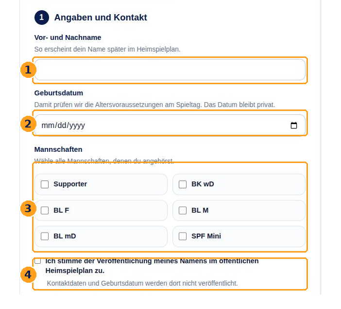

*Abbildung 1: 1 Name, 2 Geburtsdatum, 3 Mannschaftsauswahl, 4 Zustimmung. Darunter folgen die Kontaktangaben und die Codeanforderung.*

Nach der Kontaktbestätigung erscheint **Deine Registrierung wartet auf Freigabe.** Die Admins werden über die neue Anmeldung informiert. Warte auf die Freigabe; du erhältst bei erfolgreicher Freigabe eine Willkommensnachricht und kannst dich anschließend anmelden. Deine gewählten Mannschaften werden gemeinsam mit deinem Benutzerkonto freigegeben. Ein MV kann diese Freigabe nicht erteilen.

## 4 Anmelden und abmelden

### Einen Code anfordern

Ein Passwort brauchst du nicht. Öffne **Anmelden**, gib einen bereits hinterlegten Kontakt ein und wähle **E-Mail** oder **SMS**. Der Code geht ausschließlich an den ausgewählten Kontaktweg, auch wenn beide Angaben gespeichert sind.

Bei einer Mobilnummer wählst du zuerst die Ländervorwahl, zum Beispiel **Deutschland (+49)**, und gibst anschließend die nationale Nummer ein. Für weitere Länder gibt es **Andere Ländervorwahl**. In der späteren Profilpflege wird die Nummer vollständig mit Landesvorwahl geführt.

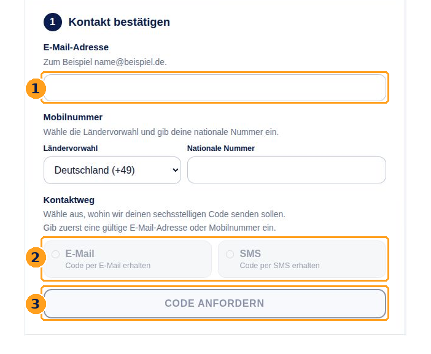

*Abbildung 2: 1 Kontakt eingeben, 2 Zustellweg wählen, 3 Code anfordern. Solange kein gültiger Kontakt eingetragen ist, sind die zugehörigen Schaltflächen deaktiviert.*

### Den Code bestätigen

Lass die Anmeldeseite geöffnet. Lies den Code aus deiner E-Mail oder SMS ab und trage die sechs Ziffern in **Sechsstelliger Code** ein. Wähle **ANMELDEN**. Der Code ist 15 Minuten gültig und kann nur einmal verwendet werden. Ein neu angeforderter Code ersetzt den vorherigen Anmeldecode.

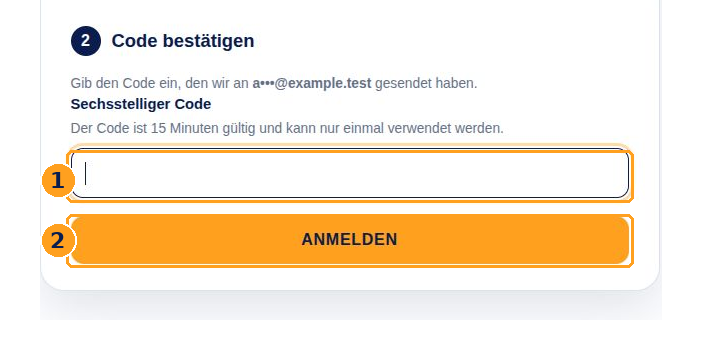

*Abbildung 3: 1 Sechsstelligen Code eingeben, 2 Anmeldung abschließen. Mit Angaben ändern kehrst du zur Kontaktangabe zurück.*

Die Meldung **Falls die Angaben bekannt sind, wurde ein sechsstelliger Code versendet.** bestätigt nicht, dass ein Konto gefunden wurde oder eine Nachricht angekommen ist. Prüfe bei ausbleibendem Code den Kontakt, den gewählten Zustellweg und den Spamordner. Häufige Anforderungen oder Fehlversuche können vorübergehend begrenzt werden.

### Sitzung beenden

Nach einer Stunde ohne Aktivität endet die Anmeldung. Fordere dann einen neuen Code an. Auf einem gemeinsam genutzten Gerät wählst du nach der Nutzung ausdrücklich **Abmelden**. Das Schließen eines Browserfensters ersetzt die Abmeldung nicht zuverlässig.

## 5 Den Heimspielplan verstehen

Der Heimspielplan ist die zentrale Übersicht. Er zeigt die aktuelle Saison, Monate und darunter die einzelnen Heimspieltage. Ein Tag enthält Vorbereitung, Kuchenlieferung, die einzelnen Spiele und Aufräumen. Über **Vergangene Spieltage** kannst du ältere Termine der Saison aufklappen.

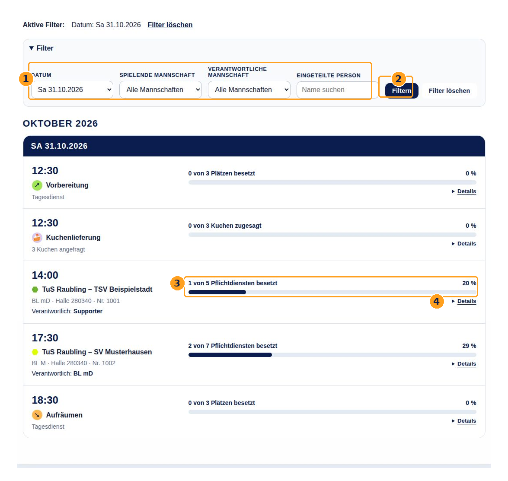

*Abbildung 4: 1 Filter einstellen, 2 Auswahl anwenden, 3 Besetzungsstand eines Spiels lesen, 4 die jeweilige Karte über Details öffnen.*

### Was du auf einer Spielkarte erkennst

- **Uhrzeit:** Der angesetzte Spielbeginn. Für viele Aufgaben musst du früher vor Ort sein; lies dazu die Aufgabeninformation über **i**.
- **Begegnung:** Die spielenden Mannschaften. Ein Spielfest wird als **Spielfest** mit seiner Altersklasse angezeigt.
- **Altersklasse, Halle und Nummer:** Sie helfen dabei, das richtige Spiel eindeutig zu erkennen. Verwechsle ähnliche Begegnungen nicht.
- **Verantwortlich:** Die Mannschaft, die die Helferorganisation für dieses Spiel übernimmt. Das ist eine eigene Zuordnung und kann von der spielenden Mannschaft abweichen oder noch **– offen –** sein.
- **Besetzungsbalken:** Zum Beispiel **1 von 5 Pflichtdiensten besetzt**. Er zählt belegte Plätze. Eine laufende Ersatzsuche lässt den Platz belegt.
- **Zusätzliche Hinweise:** Ungeklärte Altersklassen oder Altersanforderungen werden gesondert angezeigt. Ein voller Balken allein beweist deshalb noch keine vollständig passende Besetzung.

Ein Klick oder Tippen auf **Details** öffnet die einzelnen Aufgaben. Ein weiterer Klick schließt die Karte. Das reine Öffnen, Lesen oder Filtern übernimmt keinen Dienst. Über **i** neben einer Aufgabe öffnest du deren Beschreibung.

## 6 Spiele und eigene Dienste finden

Mit den Filtern begrenzt du die angezeigten Termine. Auf schmalen Bildschirmen musst du den Bereich **Filter** gegebenenfalls zuerst öffnen.

| Filter | Wofür du ihn verwendest |
| --- | --- |
| Datum | Einen bestimmten Heimspieltag auswählen. |
| Spielende Mannschaft | Die Spiele einer Mannschaft finden. Tagesdienste des passenden Spieltags bleiben sichtbar. |
| Verantwortliche Mannschaft | Spiele finden, für deren Helferorganisation eine Mannschaft eingetragen ist. Tagesdienste werden dabei ausgeblendet, weil sie keine verantwortliche Mannschaft haben. |
| Eingeteilte Person | Spiele und Tagesdienste mit einem eingeteilten Namen finden. Ein Teil des Namens genügt; Groß- und Kleinschreibung sind unerheblich. |

1. Öffne **Heimspielplan** und den Bereich **Filter**.
2. Wähle einen oder mehrere Filter aus. Mehrere Filter gelten gemeinsam; dadurch kann die Trefferliste sehr kurz werden.
3. Wähle **Filtern**. Die Zeile **Aktive Filter** nennt die angewandten Einschränkungen.
4. Mit **Filter löschen** kehrst du zur ungefilterten Ansicht im freigegebenen Anzeigezeitraum zurück.

### Die eigenen Dienste prüfen

Gib deinen Namen unter **Eingeteilte Person** ein und wähle **Filtern**. Du erhältst die Spiele und Tagesblöcke, in denen ein passender Name eingeteilt ist. Öffne die Karten und prüfe jeweils die konkrete Aufgabe. Ein Treffer auf ein Spiel bedeutet nicht, dass du alle Aufgaben dieses Spiels übernommen hast.

Gleiche Namen können zu unterschiedlichen Personen gehören. Prüfe bei der Auswahl immer auch die angezeigten Mannschaften. Die Namenssuche kann mehrere gleichnamige Personen treffen.

**Keine Treffer:** Lösche zuerst die Filter. Prüfe danach **Vergangene Spieltage** und einen möglichen Hinweis auf ausgeblendete Heimspieltage. **Filter löschen** hebt eine vom Admin gespeicherte Ausblendung nicht auf.

## 7 Welche Aufgaben es gibt

Die Aufgabenbeschreibung hinter **i** ist deine erste Anlaufstelle. Der Webservice organisiert Zusagen; er ersetzt keine praktische Einweisung in Geräte, Halle oder Vereinsabläufe. Kläre offene Fragen vor dem Einsatz mit der Vereinsorganisation.

| Dienst | Plätze je Spiel | Aufgabe und Vorbereitung |
| --- | --- | --- |
| Zeitnehmer | 1 | Spieluhr und Anzeigetafel bedienen, Zeitstrafen verwalten und auf korrekte Wechsel achten. Mindestens eine Stunde vor Spielbeginn da sein. |
| Sekretär | 1 | Den elektronischen Spielbericht mit nuScore führen und auf korrekte Wechsel achten. Mindestens eine Stunde vor Spielbeginn da sein. |
| Verkauf 1 und Verkauf 2 | 2 insgesamt | Speisen und Getränke vorbereiten und während des Spiels verkaufen. Mindestens eine Stunde vor Spielbeginn da sein. |
| Ordner | 1 | Für einen sicheren Ablauf sorgen und sichtbar gekennzeichnet sein. Mindestens eine Stunde vor Spielbeginn da sein. |
| Kasse | 1 bei Erwachsenenspielen | Eintrittskarten verkaufen und den Ordner unterstützen. Mindestens eine Stunde vor Spielbeginn da sein. |
| Wischer | 1 bei Erwachsenenspielen | Sich in Spielfeldnähe bereithalten und bei Bedarf einzelne Stellen wischen; nicht auf der Auswechselbank Platz nehmen. |

Zeitnehmer, Sekretär und Ordner nehmen laut Aufgabenbeschreibung an den technischen Besprechungen mit den Schiedsrichtern spätestens 30 Minuten vor und direkt nach dem Spiel teil. Für Kasse und Wischer ist diese Teilnahme nicht erforderlich. Die Aufgabenbeschreibungen verlangen keine offizielle Zeitnehmer- oder Sekretär-Schulung.

Erwachsenenspiele haben **sieben Pflichtplätze**. Jugendspiele und Spielfeste haben **fünf Pflichtplätze**: Zeitnehmer, Sekretär, zwei Verkauf und Ordner. Ungeklärte Altersklassen zeigen ebenfalls diese fünf Plätze, können aber weitere Einteilungen wegen ungeklärter Altersvoraussetzungen verhindern.

**Eine Person übernimmt höchstens einen Dienst pro Spiel.** Sobald du eingeteilt bist, stehst du für andere Aufgaben desselben Spiels nicht mehr zur Auswahl. Dienste bei verschiedenen Spielen und zusätzliche Tagesdienste sind davon unabhängig möglich. Prüfe selbst, ob sich deine Einsatzzeiten überschneiden; aus einer auswählbaren Kombination folgt keine zeitliche Zusagefreiheit.

## 8 Altersvoraussetzungen verstehen

Für die Altersprüfung zählt dein Alter **am angesetzten Spieltag**. Ein Geburtstag bis einschließlich dieses Tages wird berücksichtigt. Deine vollständigen Geburtsdaten werden dabei nicht im Heimspielplan veröffentlicht.

| Aufgabe | Jugend und Spielfest | Erwachsenenspiel |
| --- | --- | --- |
| Zeitnehmer | Mindestens 14 Jahre | Mindestens 16 Jahre |
| Sekretär | Mindestens 14 Jahre | Mindestens 16 Jahre |
| Ordner | Mindestens 18 Jahre | Mindestens 18 Jahre |
| Verkauf | Keine Altersanforderung | Bei vollständiger Besetzung muss mindestens eine der beiden eingeteilten Personen 18 Jahre oder älter sein. |
| Kasse und Wischer | Werden hier regulär nicht angeboten | Keine zusätzliche Altersgrenze im Webservice |

Für Zeitnehmer, Sekretär und Ordner muss ein Geburtsdatum bekannt sein. Bei einer ungeklärten Altersklasse kann der Webservice neue Einteilungen als Zeitnehmer oder Sekretär nicht erlauben. Die Ordnergrenze von 18 Jahren gilt bei jeder Altersklasse. Die Verkaufsregel für Erwachsene gilt auch bei ungeklärten Klassen. Ein fehlendes oder ungültiges Spieldatum kann eine Einteilung ebenfalls verhindern.

### Warum der Verkauf manchmal nur bestimmte Personen anbietet

Bei Erwachsenen und ungeklärten Klassen darf zunächst auch eine jüngere Person oder eine Person ohne bekanntes Geburtsdatum einen Verkaufsplatz übernehmen, solange noch ein Verkaufsplatz frei bleibt. Mit der Besetzung des letzten Platzes muss mindestens eine tatsächlich eingeteilte Person volljährig sein.

**Beispiel:** Lena ist noch nicht 18 und übernimmt Verkauf 1. Verkauf 2 muss dann eine Person übernehmen, die am Spieltag mindestens 18 Jahre alt ist. Ein erwachsener MV außerhalb der Verkaufseinteilung erfüllt diese Bedingung nicht. Bei einem Jugendspiel oder Spielfest gibt es diese Einschränkung im Verkauf nicht.

### Ein Name steht bereits dort und trotzdem erscheint ein Altershinweis

Vorhandene Einteilungen bleiben zum Beispiel nach einer Datumskorrektur oder einer Änderung der Altersklasse sichtbar. Der Hinweis macht auf die noch zu klärende Voraussetzung aufmerksam. Ergänze oder berichtige dein Geburtsdatum in der Profilpflege oder organisiere vor der Sperre einen geeigneten Ersatz. Eine solche Unstimmigkeit hebt weder die Zusage noch die Sperre auf. Für Vorbereitung, Kuchenlieferung und Aufräumen gibt es keine zusätzlichen Altersregeln im Webservice.

## 9 Einen freien Dienst verbindlich übernehmen

Du brauchst ein freigeschaltetes Konto. Ein normales Mitglied kann sich selbst eintragen; weitere auswählbare Personen hängen von MV- oder Adminrechten ab.

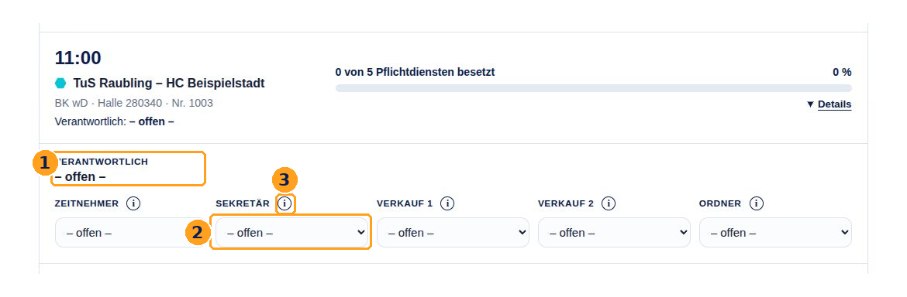

*Abbildung 5: 1 Verantwortliche Mannschaft, 2 Auswahl eines freien Sekretärdienstes, 3 Informationen zur Aufgabe. Die angezeigte Spielzeit ist nicht automatisch deine Ankunftszeit.*

1. Öffne das passende Spiel über **Details** und lies die Aufgabeninformation **i**.
2. Wähle bei einem freien Dienst deinen Namen. Die Auswahlliste wird beim Öffnen der Karte geladen. Falls nötig, nutze **Erneut laden**.
3. Prüfe im Dialog **Dienst verbindlich bestätigen** die Person, Aufgabe und den Spieltag. Lies den Hinweis zur Verantwortung und Sperrfrist.
4. Wähle **Bestätigen**, um die Zusage zu speichern. **Abbrechen**, Escape oder das Schließen des Dialogs speichern keine Einteilung.
5. Warte auf das Ergebnis. Kontrolliere den Namen und den Status an der Aufgabe. Bei einem Fehler ist die bloße Auswahl noch keine erfolgreiche Zusage.

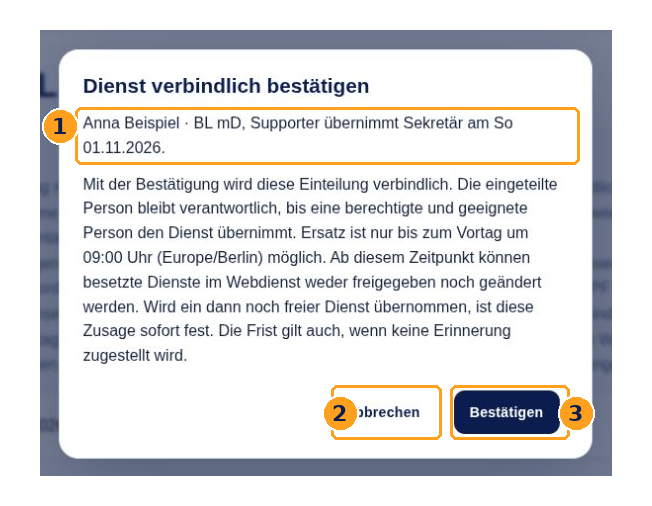

*Abbildung 6: 1 Angaben prüfen, 2 ohne Zusage abbrechen, 3 verbindlich bestätigen.*

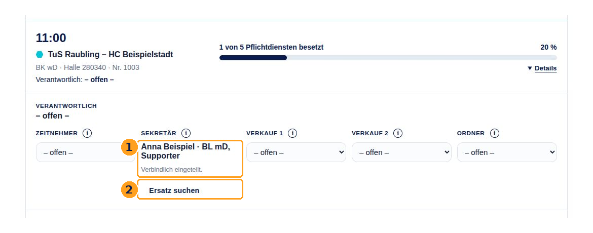

*Abbildung 7: 1 Name und Verbindlich eingeteilt zeigen die gespeicherte Zusage, 2 Ersatz suchen ist vor der Sperre verfügbar.*

**Nach der Frist:** Ein noch freier Dienst kann innerhalb deiner Rechte weiter übernommen werden. Die Bestätigung weist darauf hin, dass die Zusage sofort fest wird. Ein bereits besetzter Dienst kann dann nicht mehr gewechselt werden.

**Ohne JavaScript:** Wenn Skripte im Browser deaktiviert sind, führt **Dienst bearbeiten** zu einer eigenen Formularseite. Wähle dort die Person, danach **Weiter zur Bestätigung** und erst anschließend **Bestätigen**. Auch dort speichert **Abbrechen** keine Zusage.

## 10 Ersatz suchen und einen Dienst übernehmen

### Für einen eigenen Dienst Ersatz suchen

1. Öffne den Heimspielplan und deinen eingeteilten Dienst.
2. Wähle vor dem Vortag um 09:00 Uhr **Ersatz suchen**.
3. Kontrolliere den Status **Ersatz gesucht**. Dein Name bleibt stehen: Du bist weiterhin eingeteilt und verantwortlich.
4. Suche rechtzeitig eine geeignete Person und bitte sie, den Dienst im Webservice zu übernehmen. Aus der Ersatzsuche entsteht kein automatischer Rundruf an alle Helfer.

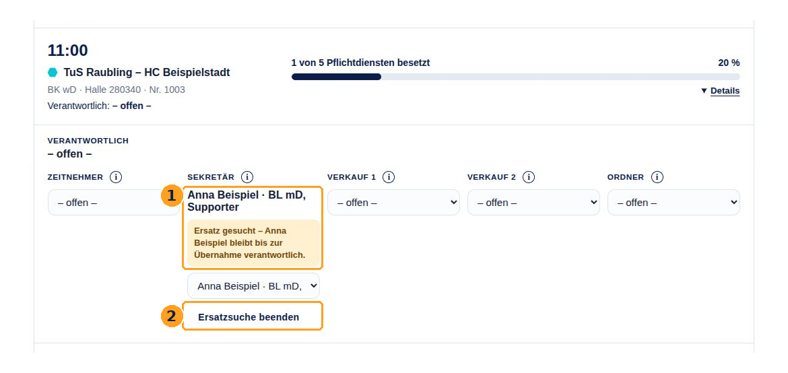

*Abbildung 8: 1 Der Dienst bleibt mit Anna Beispiel besetzt und verantwortlich zugeordnet, 2 Ersatzsuche beenden schließt nur die Suche.*

Du kannst eine eigene offene Suche vor der Sperre über **Ersatzsuche beenden** zurücknehmen. Dabei bleibst du auf demselben Dienst eingeteilt. Wenn du später erneut suchst, muss eine Ersatzperson die dann aktuelle Suche verwenden.

### Einen angebotenen Dienst als Ersatz übernehmen

1. Melde dich mit deinem eigenen Konto an und öffne einen Dienst mit **Ersatz gesucht**.
2. Wähle dich in der Ersatz-Auswahl aus. Bist du dort nicht auswählbar, prüfe Alter, andere Dienste beim selben Spiel und deine Berechtigungen.
3. Lies die Bestätigung und klicke auf **Bestätigen**.
4. Prüfe, dass jetzt dein Name eingetragen ist. Erst die erfolgreiche Übernahme löst die bisherige Person aus ihrer Verantwortung für diesen Dienst.

Eine Ersatzperson für den Verkauf bei Erwachsenen muss zusammen mit der verbleibenden Verkaufsperson weiterhin die Volljährigkeitsregel erfüllen. Die ausgetauschte Person zählt nach der Übernahme dafür nicht mehr mit.

### Was zur Sperrfrist passiert

Besetzte Dienste werden am Vortag um 09:00 Uhr deutscher Ortszeit fest, offene Ersatzsuchen enden. Das gilt auch ohne zugestellte Erinnerung. Ein für Samstag angesetzter Dienst wird also am Freitag um 09:00 Uhr fest; es gibt keine Frist von 24 Stunden vor Spielbeginn.

**Kurzfristiger Ausfall nach der Sperre:** Informiere umgehend deine Mannschaftsverantwortlichen oder die Vereinsorganisation direkt. Im Webservice gibt es dafür keine Freigabe und keinen Admin-Schalter zum Wechseln. Die gespeicherte Verantwortung bleibt bestehen. Auch eine spätere Spielverschiebung hebt eine bereits bestehende Sperre nicht automatisch auf.

## 11 Vorbereitung und Aufräumen übernehmen

Vorbereitung und Aufräumen gehören zum gesamten Heimspieltag. Sie sind von den Aufgaben eines einzelnen Spiels unabhängig und haben keine verantwortliche Mannschaft.

| Tagesdienst | Plätze | Zeitpunkt und Aufgabe |
| --- | --- | --- |
| Vorbereitung | 3 | Zur angezeigten Uhrzeit beim Aufbau von Spielfeld und Verkaufsstand helfen. Die Zeit wird aus dem frühesten gültigen Spielbeginn des Tages minus 90 Minuten berechnet. |
| Aufräumen | 3 | Zur angezeigten Uhrzeit beim Abbau des Verkaufsstands und Reinigen des Spielfelds helfen. Die Zeit wird aus dem spätesten gültigen Spielbeginn des Tages plus 60 Minuten berechnet. |

**Beispiel:** Beginnt das erste Spiel um 14:00 Uhr und das letzte um 17:30 Uhr, zeigt der Plan Vorbereitung um 12:30 Uhr und Aufräumen um 18:30 Uhr. Maßgeblich für deine Planung ist die aktuelle Anzeige im Webservice. Geänderte Spielzeiten können diese berechneten Uhrzeiten verändern. Falls **Zeit offen** erscheint, kläre die Ankunftszeit mit der Organisation.

### So trägst du dich ein

1. Öffne den gewünschten Tag. Entferne einen Filter auf **Verantwortliche Mannschaft**, falls die Tagesdienste fehlen.
2. Öffne **Vorbereitung** oder **Aufräumen** über **Details**.
3. Wähle dich auf einem freien Platz aus und bestätige die verbindliche Einteilung.
4. Prüfe deinen Namen und den gespeicherten Status.

Pro Tagesblock darfst du genau einen Platz übernehmen. Du kannst unabhängig davon einen Spielauftrag und je einen Platz in anderen Tagesblöcken haben, zum Beispiel Vorbereitung und Kuchenlieferung. Prüfe, ob die Aufgaben zeitlich zusammenpassen.

Für diese Tagesdienste gelten dieselben Regeln zur Ersatzsuche, Bestätigung und Sperre wie für Spielaufgaben. Mitglieder und MVs verwalten dabei nur ihre eigenen Tagesdienste; die MV-Zuständigkeit für ein Team erweitert hier die Auswahl nicht. Admins können andere aktive Personen einteilen, solange alle übrigen Regeln erfüllt sind.

## 12 Einen Kuchen zusagen und Kuchen planen

### Als Helferin oder Helfer einen Kuchen zusagen

Die Karte **Kuchenlieferung** steht zwischen Vorbereitung und Spielen. Ein Platz entspricht **einem Kuchen**. Öffne **Details**, prüfe die Lieferzeit und wähle dich auf einem freien Platz aus. Bestätige die Zusage wie bei jedem anderen Dienst. Bringe den Kuchen zur angegebenen Zeit an den Verkaufsstand.

Du kannst pro Kuchenblock einen Platz übernehmen. Eine Kuchenlieferung ist unabhängig von deinen Spiel-, Vorbereitungs- und Aufräumdiensten. Ersatzsuche und Sperre gelten auch hier.

Steht dort **Admin-Einrichtung erforderlich**, sind Anzahl und Lieferzeit noch nicht vollständig festgelegt. Es gibt dann noch keine übernehmbaren Plätze. **Keine Kuchen angefragt** bedeutet dagegen ausdrücklich, dass für diesen Tag keine Kuchen benötigt werden.

### Als Admin die Kuchenlieferung einrichten

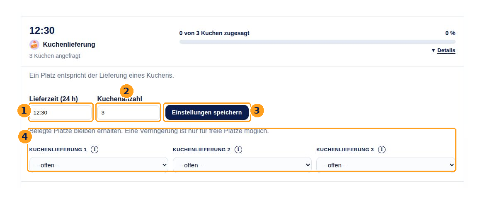

*Abbildung 9: 1 Lieferzeit im Format HH:MM, 2 Kuchenanzahl, 3 Einstellungen speichern, 4 ein Platz je Kuchen. Die Einstellfelder sehen nur Admins.*

1. Öffne **Kuchenlieferung** über **Details**.
2. Trage **Lieferzeit (24 h)** ein, zum Beispiel **12:30**.
3. Trage eine ganze **Kuchenanzahl** ab null ein und wähle **Einstellungen speichern**.
4. Prüfe die gespeicherte Zeit, Anzahl und die entstandenen Plätze. Die Anzahl **0** bedeutet ausdrücklich keine Kuchen; eine offene Anzahl bedeutet noch nicht eingerichtet.

Die Lieferzeit wird gespeichert und bleibt beim Heimspieldatum, auch wenn sich Spielanfangszeiten ändern. Eine größere Anzahl ergänzt freie Plätze. Eine kleinere Anzahl darf keinen belegten wegfallenden Platz entfernen.

**Beispiel:** Platz 4 ist belegt. Eine Reduzierung von vier auf zwei Kuchen wird abgelehnt, selbst wenn Platz 1 und 2 frei sind. Eine Ersatzsuche oder Übernahme macht Platz 4 nicht frei; der Platz bleibt belegt. Vorhandene Personen werden auch nicht automatisch auf kleinere Platznummern verschoben.

## 13 Eigene Daten pflegen

Über **Helfer verwalten** siehst du die Helferliste. Normale Mitglieder können dort die eigenen Stammdaten bearbeiten. Der Seitentitel bedeutet nicht, dass du die Daten aller anderen bearbeiten darfst.

1. Öffne **Helfer verwalten**.
2. Suche deinen Namen über **Name** und **Filtern**. Bei Bedarf kannst du zusätzlich nach einer Mannschaft filtern. **Zurücksetzen** entfernt diese Filter.
3. Öffne auf deiner Karte **Bearbeitung**.
4. Korrigiere Name, Geburtsdatum, E-Mail oder Telefonnummer. Telefonnummern werden hier vollständig mit Landesvorwahl eingegeben, zum Beispiel in der Form **+49…**.
5. Wähle **Speichern** und prüfe die Erfolgsmeldung. Bei einem markierten Feldfehler korrigiere das betroffene Feld und speichere erneut.

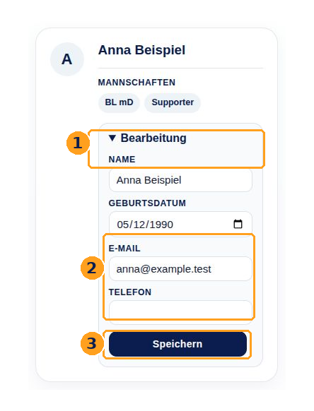

*Abbildung 10: 1 Bearbeitung öffnen, 2 Kontaktfelder pflegen, 3 speichern. Die vollständigen Daten dieser Ansicht sehen die Person selbst und Admins.*

Ein unbekanntes Geburtsdatum aus einem älteren Datensatz darfst du ergänzen; ein bekanntes Datum darfst du korrigieren, aber nicht leeren. Eine reine Kontaktkorrektur ist bei einem älteren Datensatz mit unbekanntem Datum weiterhin möglich. Dein Geburtsdatum darf nicht in der Zukunft liegen.

**Mindestens einen erreichbaren Kontakt behalten:** Entfernst du E-Mail und Telefonnummer, kannst du dich später nicht erneut per Code anmelden. E-Mail-Adressen und Telefonnummern müssen eindeutig sein. Bei **wird bereits verwendet** wende dich an einen Admin, statt ein zweites Konto anzulegen.

Deine Mannschaften stehen als Kennzeichnungen auf der Karte. Als normales Mitglied kannst du sie nach der Registrierung nicht selbst ändern; bitte deinen MV oder einen Admin darum. Admins können alle Mannschaftszugehörigkeiten pflegen, MVs nur die von ihnen betreuten Mannschaften.

## 14 Die Statistik lesen

Öffne **Statistik** in der oberen Navigation. Dafür brauchst du ein aktives Konto. Die Bereiche lassen sich über ihre Überschriften auf- und zuklappen.

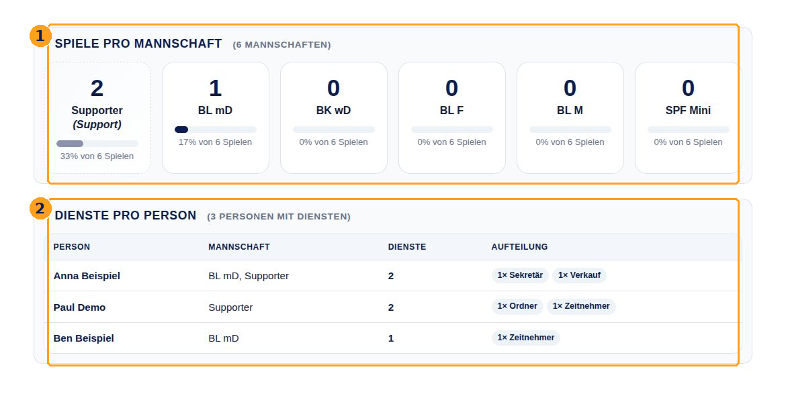

*Abbildung 11: 1 Spiele pro verantwortlicher Mannschaft, 2 Anzahl und Aufteilung der eingeteilten Dienste pro Person.*

### Spiele pro Mannschaft

Die Zahl gibt an, wie vielen Spielen eine Mannschaft als **verantwortliche Mannschaft** zugeordnet wurde. Sie zählt nicht die eigenen ausgetragenen Spiele und sagt nicht, ob alle Helferplätze besetzt sind. Die Prozentangabe bezieht sich auf alle Spiele der aktuellen Saison. Spiele ohne verantwortliche Mannschaft können dazu führen, dass die Mannschaftsanteile zusammen unter 100 Prozent liegen.

### Dienste pro Person

Hier siehst du die Zahl der gespeicherten Dienste einer Person in der Saison und die Aufteilung nach Aufgaben. Spielaufgaben sowie Vorbereitung, Aufräumen und Kuchenlieferung zählen mit. Vergangene Dienste und erhaltene Einteilungen auf nicht mehr regulär angebotenen Aufgaben werden ebenfalls berücksichtigt.

Die Statistik zählt Einteilungen, keine bestätigte Anwesenheit und keine geleisteten Stunden. Eine Ersatzsuche bleibt bis zur Übernahme bei der bisherigen Person gezählt. Nach einer erfolgreichen Übernahme zählt die aktuelle Einteilung bei der Ersatzperson.

### Offene Dienste Altersanforderungen und Einrichtung

Dieser Bereich zeigt aktuelle und künftige Spiele oder Tagesblöcke mit freien Plätzen, ungeklärten Altersanforderungen oder notwendiger Admin-Einrichtung, zum Beispiel für Kuchen. Der Wert in der Überschrift zählt betroffene Spiele oder Blöcke, nicht die Summe aller fehlenden Helfer.

Eine Einschränkung der sichtbaren Spieltage wirkt auf diese Problemliste. **Spiele pro Mannschaft** und **Dienste pro Person** bleiben dagegen Auswertungen der gesamten Saison. Lies deshalb einen Hinweis zum angezeigten Zeitraum, bevor du aus einer leeren Problemliste auf die gesamte Saison schließt.

## 15 Als Mannschaftsverantwortlicher organisieren

Als MV hast du zunächst alle Möglichkeiten eines normalen Mitglieds. Zusätzlich organisierst du die Mannschaften, für die ein Admin dich ausdrücklich als MV hinterlegt hat. Jede Mannschaft hat höchstens einen MV; eine Person kann mehrere Teams betreuen.

### Die Besetzung der eigenen verantwortlichen Spiele prüfen

Filtere im Heimspielplan nach deiner Mannschaft unter **Verantwortliche Mannschaft**. Prüfe freie Plätze und zusätzliche Altershinweise. Die Auswahl richtet sich nach der verantwortlichen Mannschaft des Spiels, nicht allein danach, welches Team gerade spielt.

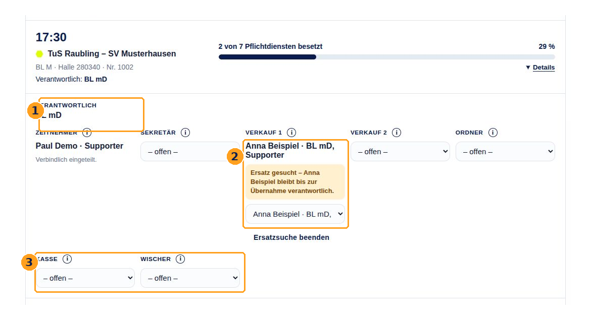

*Abbildung 12: 1 BL mD ist für dieses Erwachsenenspiel verantwortlich, 2 ein belegter Verkaufsdienst wird zum Ersatz angeboten, 3 Kasse und Wischer gehören zu den zusätzlichen Erwachsenenaufgaben.*

Bei einem Spiel, für das deine Mannschaft verantwortlich ist, kannst du dich selbst oder aktive Mitglieder dieser Mannschaft auf freie Plätze beziehungsweise als Ersatz einteilen. Sprich die Zusage vorher mit der betroffenen Person ab. Prüfe im Bestätigungsdialog den richtigen Namen. Ein bereits belegter Dienst muss zuerst zum Ersatz angeboten werden; eine feste Einteilung lässt sich nicht einfach überschreiben.

Die vorhandene Einteilung einer fremden Person erweitert deine MV-Rechte nicht. Für Spiele außerhalb deiner zuständigen verantwortlichen Mannschaften kannst du wie ein Mitglied nur eigene Dienste verwalten. Bei Tagesdiensten einschließlich Kuchen gilt ebenfalls nur die eigene Einteilung.

### Mannschaftszugehörigkeiten pflegen

Unter **Helfer verwalten** kannst du über **Bearbeitung** und **Mannschaften bearbeiten** aktive Personen zu deinen Teams hinzufügen oder daraus entfernen. Andere Teamzugehörigkeiten bleiben erhalten. Speichere mit **Mannschaften speichern**. Deine eigene für die MV-Funktion notwendige Zugehörigkeit ist mit **Als MV erforderlich** geschützt.

Über **Neue Benutzer** kannst du eine neue Person direkt aktiv in einer deiner Mannschaften anlegen. Name, Geburtsdatum und eine zulässige Mannschaft sind erforderlich. E-Mail und Telefon sind optional, für Anmeldung und Benachrichtigungen aber nötig. Bestehende Personen ordnest du über ihre vorhandene Karte zu. Du kannst keine offenen Registrierungen freigeben und keine fremden Kontakt- oder Geburtsdaten nachträglich pflegen.

## 16 Als Admin Benutzer verwalten

Unter **Helfer verwalten** findest du die Verwaltung und darunter die Mitgliederliste mit zusätzlichen Filtern für Status und fehlende Geburtsdaten.

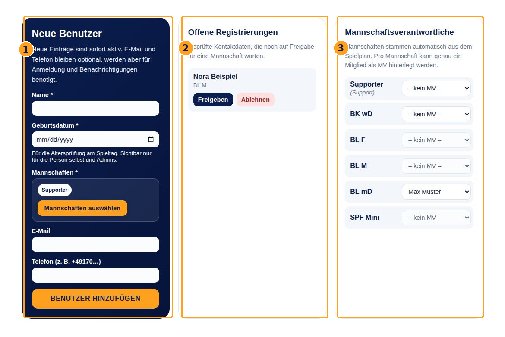

*Abbildung 13: 1 Neue aktive Person anlegen, 2 kontaktbestätigte Registrierung freigeben oder ablehnen, 3 Mannschaftsverantwortliche auswählen.*

### Registrierungen entscheiden

Im Bereich **Offene Registrierungen** erscheinen Anmeldungen mit bereits bestätigtem Kontakt. Prüfe Name und Mannschaftszugehörigkeiten. **Freigeben** aktiviert das Konto und veranlasst eine Willkommensnachricht. **Ablehnen** lehnt die Registrierung ab. Warte jeweils auf die Rückmeldung der Oberfläche. Die Kontaktprüfung allein ist noch keine Freigabe.

### Eine Person direkt anlegen

Prüfe zuerst mit der Namenssuche, ob die Person schon vorhanden ist. Fülle unter **Neue Benutzer** Name und Geburtsdatum aus. Öffne **Mannschaften auswählen**, setze die passenden Häkchen und wähle **Auswahl übernehmen**. **Supporter** ist zunächst vorbelegt; prüfe, ob diese Zugehörigkeit beabsichtigt ist. Ergänze möglichst einen erreichbaren Kontakt und klicke auf **BENUTZER HINZUFÜGEN**. Die Person ist sofort aktiv und benötigt keine Registrierungsfreigabe. Erst der abschließende Hinzufügen-Klick legt die Person an.

### Bestehende Daten ändern

Filtere die Mitgliederliste, öffne **Bearbeitung** und speichere die benötigten Korrekturen. Über **Mannschaften bearbeiten** und **Mannschaften speichern** legst du die vollständige Zugehörigkeitsliste fest. Entfernte Häkchen entfernen die jeweilige Mitgliedschaft. Entferne nicht die Mitgliedschaft eines eingesetzten MVs, ohne vorher die MV-Zuordnung zu klären.

### Ausscheiden und irrtümliche Datensätze

**Deaktivieren** ist für eine ausscheidende Person vorgesehen. Aktuelle oder zukünftige Spiel- oder Tagesdienste verhindern die Deaktivierung. Organisiere rechtzeitig geeignete Übernahmen vor der Sperre. Bei ausschließlich vergangenen Diensten ist eine Deaktivierung möglich; diese Historie bleibt erhalten. Erfolgreiches Deaktivieren entfernt MV-Zuständigkeiten. **Reaktivieren** macht das Konto wieder aktiv, stellt aber keine früheren MV-Zuordnungen automatisch her.

**Löschen** ist für irrtümliche Datensätze vorgesehen und verlangt eine Bestätigung. Jede vorhandene Einteilung verhindert das Löschen, auch eine vergangene. Es gibt keine erzwungene Entfernung verbindlicher Dienste durch Löschen oder Deaktivieren. Historische Protokolle werden nicht nachträglich umgeschrieben.

## 17 Als Admin Mannschaften und Dienste organisieren

### Einen MV festlegen

Öffne **Helfer verwalten** und den Bereich **Mannschaftsverantwortliche**. Wähle für die gewünschte Mannschaft ein aktives Mitglied aus. Die Änderung wird direkt beim Wechsel der Auswahl gespeichert; prüfe die Rückmeldung. Mit **– kein MV –** entfernst du die MV-Zuordnung. Ist niemand auswählbar, ergänze zuerst eine passende aktive Mitgliedschaft.

Mannschaften entstehen automatisch aus den Altersklassen des eingelesenen Spielplans; zusätzlich gibt es **Supporter**. Du kannst in der Weboberfläche keine Mannschaft frei anlegen, umbenennen oder löschen. Fehlt eine spielende Mannschaft, muss die Organisation den eingelesenen Spielplan prüfen.

### Eine verantwortliche Mannschaft bestimmen

1. Öffne im **Heimspielplan** die passende Spielkarte.
2. Wähle bei **Verantwortlich** die Mannschaft, die die Helferorganisation übernehmen soll.
3. Prüfe die Rückmeldung und den Namen in der Kartenzusammenfassung.

Die Auswahl speichert direkt. **– offen –** entfernt die Verantwortlichkeitszuordnung. Dadurch verschwinden keine bereits bestätigten Dienste. Das spielende Team wird nicht automatisch als Helferteam eingetragen, weil es selbst mit dem Spiel beschäftigt ist.

### Geeignete Personen auswählen

Innerhalb deiner Rechte zeigen die Auswahllisten zuerst Mitglieder der verantwortlichen Mannschaft, danach Supporter, dann weitere Personen und zuletzt Personen der spielenden Mannschaft. Mannschaftszugehörigkeiten stehen neben den Namen.

**spielt selbst** und der Hinweis auf eine andere Mannschaft sind organisatorische Warnungen. Solche Personen bleiben auswählbar, wenn die übrigen Voraussetzungen erfüllt sind. Eine unzulässige Altersvoraussetzung oder ein anderer Dienst beim selben Spiel kann eine Person dagegen vollständig aus der Auswahl entfernen. Kläre Warnungen vor der Zusage.

### Was Adminrechte nicht aufheben

Du kannst keinen normal angebotenen besetzten Dienst ersatzlos leeren. Nutze vor der Sperre die Ersatzsuche und die bestätigte Übernahme. Altersvoraussetzungen und feste Einteilungen gelten auch für Admins. Bereits belegte, wegen einer Spieländerung nicht mehr angebotene Aufgaben können als **Bestehende Einteilung – nur Freigabe** erscheinen. Nur für solche Altdienste ist vor der tatsächlichen Sperre eine berechtigte Freigabe vorgesehen; sie ist keine allgemeine Abmeldefunktion.

## 18 Als Admin Spieltage ausblenden

Mit dieser Funktion begrenzt du, bis zu welchem Termin Heimspieltage in der normalen Übersicht angezeigt werden. Die Einstellung gilt gemeinsam für alle Benutzer und bleibt bis zu einer manuellen Änderung bestehen.

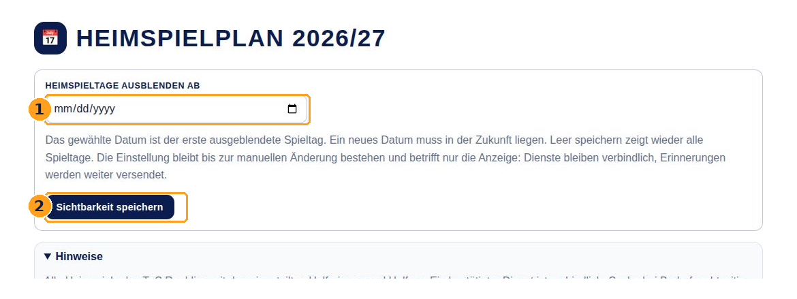

*Abbildung 14: 1 Ersten ausgeblendeten Tag wählen, 2 Sichtbarkeit speichern. Leeres Datum und erneutes Speichern zeigen wieder alle Spieltage.*

1. Öffne als Admin den **Heimspielplan**.
2. Wähle unter **Heimspieltage ausblenden ab** ein Datum in der Zukunft.
3. Klicke auf **Sichtbarkeit speichern** und prüfe die Rückmeldung.
4. Kontrolliere den Hinweis zum angezeigten Zeitraum.

**Beispiel:** Mit dem Datum **01.12.2026** werden der 1. Dezember und alle späteren Heimspieltage ausgeblendet. Das betrifft deren Spiele sowie Vorbereitung, Kuchenlieferung und Aufräumen. Um alle Tage wieder anzuzeigen, leere das Datumsfeld und speichere erneut.

**Ausblenden ändert nur die Anzeige.** Bestehende Dienste bleiben verbindlich, Sperrfristen gelten weiter und Erinnerungen werden weiterhin verarbeitet. Auch der tägliche Spielplanabgleich läuft weiter. Informiere Betroffene bei Bedarf über den organisatorischen Hintergrund der eingeschränkten Anzeige.

Als Admin kannst du über **Ausgeblendete Spieltage anzeigen** die vollständige Ansicht prüfen. Diese Vorschau verändert die gespeicherte Grenze nicht. **Ausgeblendete Spieltage wieder ausblenden** kehrt zur normalen Ansicht zurück. Mitglieder, MVs und Gäste können die Grenze nicht über diese Vorschau aufheben.

**Filter löschen** löscht nur die Suchfilter, nicht die gespeicherte Ausblendung. In der Statistik betrifft die Grenze ausschließlich die Liste offener Dienste, Altersanforderungen und nötiger Einrichtungen. Die Mannschafts- und Personenstatistik umfasst weiterhin die ganze Saison.

Wenn jemand die Einstellung zwischenzeitlich geändert hat, kann dein veralteter Speicherversuch abgelehnt werden. Prüfe dann den aktuellen gespeicherten Wert, bevor du erneut speicherst.

## 19 Das Änderungsprotokoll verwenden

Das **Änderungsprotokoll** ist nur für Admins sichtbar. Es hilft nachzuvollziehen, wer einen Dienst übernommen, eine Ersatzsuche geöffnet oder beendet hat und wann eine Einteilung fest geworden ist.

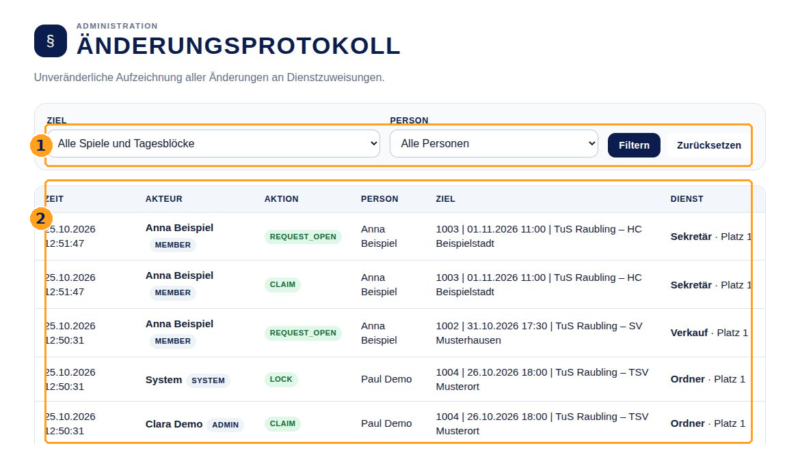

*Abbildung 15: 1 Ziel oder Person auswählen und Filtern wählen, 2 darunter die protokollierten Änderungen lesen.*

1. Öffne **Änderungsprotokoll** in der Navigation.
2. Wähle unter **Ziel** ein Spiel oder einen Tagesblock aus. Alternativ oder zusätzlich kannst du nach **Person** filtern.
3. Klicke auf **Filtern**. **Zurücksetzen** entfernt die Einschränkungen.

| Spalte | Bedeutung |
| --- | --- |
| Zeit | Zeitpunkt des protokollierten Vorgangs. |
| Akteur | Person oder System, die beziehungsweise das die Änderung ausgelöst hat, einschließlich der damaligen Rolle. |
| Aktion | Art der Änderung; einige Bezeichnungen sind technisch und englisch. |
| Person | Von der Einteilung betroffene Person beziehungsweise beteiligte Personen einer Übernahme. |
| Ziel | Gespeicherte Beschreibung des Spiels oder Tagesblocks. |
| Dienst | Damalige Aufgabenbezeichnung und Platznummer. |

Häufige Aktionsnamen sind **claim** für eine Zusage, **request_open** für eine Ersatzsuche, **request_close** für deren Beendigung, **takeover** für eine Übernahme und **lock** für eine Sperre. **release** betrifft eine zulässige Freigabe, etwa eines nicht mehr angebotenen Altdienstes; es bedeutet keine allgemeine Freigabemöglichkeit. **Durch Migration entfernt** kennzeichnet eine historische Entfernung bei einer ausdrücklich vorgesehenen Datenumstellung.

Die Einträge sind unveränderliche Nachweise und keine Rückgängig-Funktion. Historische Aufgabenbezeichnungen bleiben wörtlich erhalten und können von heutigen Bezeichnungen abweichen. Das Protokoll ist auf Dienstzuweisungen ausgerichtet und keine vollständige Liste aller Profil- und Verwaltungsänderungen. Das reine Öffnen einer Karte oder das Abbrechen einer Zusage erzeugt keine erfolgreiche Einteilung.

## 20 Erinnerungen und Benachrichtigungen

Der tägliche Hintergrundlauf aktualisiert den gespeicherten Spielplan und verarbeitet Benachrichtigungen. Die Weboberfläche zeigt den zuletzt eingelesenen Stand. Ein Neuladen deines Browsers stößt keinen neuen Abruf bei nuLiga an.

| Anlass | Was du erwarten kannst |
| --- | --- |
| Anmeldung oder Kontaktbestätigung | Einen sechsstelligen Code über den ausdrücklich gewählten Weg E-Mail oder SMS. |
| Kontaktbestätigte Neuregistrierung | Die aktiven Admins erhalten eine Information zur ausstehenden Freigabe. |
| Freigabe einer Registrierung | Die freigeschaltete Person erhält eine Willkommensnachricht. |
| Sieben Tage vor einem Spieltag | Der Tageslauf erinnert bereits eingeteilte Spiel- und Tageshelfer; für die Vorbereitung gibt es eine eigene Aufgabeninformation. |
| Vortag eines Spieltags | Der Tageslauf erinnert eingeteilte Helfer an ihre Aufgaben. Der aktive MV der verantwortlichen Mannschaft wird bei offenen Plätzen oder Altersproblemen einbezogen. |
| Erkannte Spielverschiebung | Eingeteilte Spielhelfer werden über die Änderung informiert. Prüfe den aktualisierten Termin und mögliche Auswirkungen auf deine Planung. |

Gewöhnliche Benachrichtigungen bevorzugen eine hinterlegte E-Mail-Adresse. Nur wenn keine nutzbare E-Mail vorhanden ist, wird eine vorhandene Telefonnummer verwendet. Das ist eine Auswahl des Kontaktwegs und keine Zusicherung, dass eine fehlgeschlagene E-Mail automatisch noch einmal per SMS gesendet wird. Ohne beide Kontaktmöglichkeiten kann keine Nachricht zugestellt werden.

Die erfolgreiche Speicherung deiner Einteilung erkennst du **im Heimspielplan**. Warte dafür nicht auf eine sofortige Bestätigung per E-Mail. Eine Ersatzsuche verschickt keinen automatischen Aufruf an alle Helfer.

**Erinnerungen unterstützen deine Planung, ersetzen sie aber nicht.** Speichere dir Termin, Aufgabe und Ankunftszeit selbst. Die Vortagssperre gilt auch, wenn der Hintergrundlauf ausfällt, du keinen Kontakt hinterlegt hast oder eine Nachricht nicht ankommt. Die Erinnerung eine Woche vorher macht den Dienst noch nicht fest.

Bei fehlenden Schiedsrichtern informiert das System die dafür vorgesehenen Koordinatoren. Ein Helferdienst als Ordner, Zeitnehmer oder Sekretär macht dich nicht zum Schiedsrichter. Bei unklaren oder fehlenden Terminen wende dich an die Vereinsorganisation.

## 21 Wenn etwas nicht funktioniert

### Ich bekomme keinen Code

Prüfe die Schreibweise und ob genau dieser Kontakt bereits hinterlegt ist. Kontrolliere den ausgewählten Kontaktweg und bei E-Mail auch den Spamordner. Die allgemeine Versandmeldung bestätigt aus Datenschutzgründen kein vorhandenes Konto. Bei häufigen Versuchen kann eine vorübergehende Begrenzung greifen; fordere nicht ständig weitere Codes an. Wenn es weiter nicht klappt, bitte einen Admin, Kontostatus und gespeicherte Kontaktdaten zu prüfen. Teile deinen Code nicht mit anderen.

### Der Code ist ungültig oder abgelaufen

Verwende den zuletzt angeforderten Code und gib alle sechs Ziffern ein. Ein Code gilt 15 Minuten und nur einmal. Wenn nötig, gehe über **Angaben ändern** zurück und fordere einen neuen Code an. Codes für die Registrierung und Codes für die Anmeldung sind nicht austauschbar.

### Nach der Registrierung sehe ich nur einen Status

**Deine Registrierung wartet auf Freigabe** bedeutet: Der Kontakt ist bestätigt, die Admin-Freigabe fehlt noch. Bitte einen Admin um Prüfung. Eine neue Registrierung mit denselben Angaben beschleunigt die Freigabe nicht.

### Ich sehe keine Spiele oder keine Tagesdienste

Nutze zuerst **Filter löschen**. Prüfe **Vergangene Spieltage** und einen Hinweis auf ausgeblendete Heimspieltage. Ein Filter auf **Verantwortliche Mannschaft** blendet Tagesdienste aus. Steht **Noch keine Spiele vorhanden**, muss die Organisation den Spielplanimport prüfen; das ist keine Aufgabe für normale Benutzer.

### Ich kann meinen Namen nicht auswählen

Prüfe, ob du angemeldet und freigeschaltet bist. Öffne die Karte und warte, bis die Auswahl geladen ist. Weitere Gründe sind ein anderer Dienst beim selben Spiel, eine nicht erfüllte Altersvoraussetzung, ein fehlendes Geburtsdatum, eine ungeklärte Altersklasse oder eine nicht passende Berechtigung. Ein normal besetzter Platz wird erst durch eine offene Ersatzsuche übernehmbar. Ein gesperrter besetzter Platz kann nicht mehr geändert werden.

### Die Auswahlliste bleibt deaktiviert

Bei einem Ladefehler verwende **Erneut laden** an der betroffenen Karte. Zeigt die Oberfläche **Zum Login**, melde dich neu an und öffne danach die Karte wieder. Ein normaler Browser-Neuladevorgang kann helfen, den aktuellen Zustand zu laden. Bleibt der Fehler bestehen, notiere Termin und Aufgabe für die Organisation.

### Meine Bestätigung wurde abgelehnt

Möglicherweise hat inzwischen jemand den Platz übernommen, die Ersatzsuche beendet oder eine Einstellung geändert. Auch die Sperrfrist kann zwischen Auswahl und Bestätigung erreicht worden sein. Lade den aktuellen Stand, lies die Meldung und prüfe, ob dein Name gespeichert ist. Bestätige nur eine noch verfügbare, aktuelle Auswahl erneut. Ein veralteter Versuch überschreibt keine bereits gespeicherte Einteilung.

### Die Seite meldet einen vorübergehenden Fehler

Warte kurz und lade den aktuellen Stand erneut. Prüfe bei einem Fehler nach **Bestätigen** zuerst, ob deine Zusage bereits angezeigt wird, bevor du einen weiteren Versuch startest. Bleibt der Fehler bestehen, wende dich mit den betroffenen Angaben an die Organisation.

### Ich bin fest eingeteilt und falle kurzfristig aus

Kontaktiere direkt deine Mannschaftsverantwortlichen oder die Vereinsorganisation. Im Webservice bleibt die Einteilung bestehen; weder ein Admin noch eine Profiländerung kann die Sperre aufheben. Eine ausbleibende Erinnerung verlängert die Wechselmöglichkeit nicht.

### Meine Profildaten lassen sich nicht speichern

Lies den Fehler am betroffenen Feld. Häufige Gründe sind ein ungültiges oder zukünftiges Geburtsdatum, das Leeren eines bekannten Geburtsdatums, eine ungültige E-Mail oder Telefonnummer oder ein bereits verwendeter Kontakt. Nutze für Telefonangaben in der Profilpflege die vollständige Landesvorwahl. Bei einem bereits verwendeten Kontakt soll ein Admin die vorhandenen Datensätze prüfen.

### Löschen Deaktivieren oder eine Kuchenreduktion wird abgelehnt

Prüfe vorhandene Zusagen. Aktuelle und künftige Dienste blockieren eine Deaktivierung; jede Einteilung blockiert die Löschung. Eine Kuchenreduktion darf keine belegte wegfallende Platznummer entfernen. Eine Ersatzsuche macht einen Platz nicht frei. Diese Schutzregeln können nicht erzwungen umgangen werden.

### Was eine hilfreiche Fehlermeldung an die Organisation enthält

Nenne den Spieltag, die Spielzeit oder den Tagesblock, die genaue Aufgabe und den Wortlaut der Meldung. Ergänze, ob du als Mitglied, MV oder Admin angemeldet warst und ob es auf Smartphone oder Computer passiert ist. Ein Screenshot kann helfen; zeige darauf nur die benötigte Stelle und keine Anmeldecodes oder unnötigen persönlichen Angaben. Die zuständige Kontaktperson findest du über deine Vereinsorganisation; rechtliche Kontaktinformationen stehen unter **Impressum**.

## 22 Begriffe und Checkliste für den Spieltag

| Begriff | Einfach erklärt |
| --- | --- |
| Heimspielplan | Übersicht der gespeicherten Heimspiele und Helferdienste. |
| Spielende Mannschaft | Das Team, das auf dem Spielfeld antritt. |
| Verantwortliche Mannschaft | Das Team, das die Helferorganisation für dieses Spiel übernehmen soll. |
| Supporter | Zusätzliche Helfergruppe, unabhängig von einer spielenden Mannschaft. |
| MV | Mannschaftsverantwortliche Person mit erweiterten Rechten für ihre betreuten Mannschaften. |
| Dienst oder Platz | Eine einzelne Aufgabe für eine Person. Verkauf 1 und Verkauf 2 sind zwei getrennte Plätze. |
| Tagesblock | Vorbereitung, Kuchenlieferung oder Aufräumen für einen ganzen Heimspieltag. |
| Verbindlich eingeteilt | Die Zusage wurde gespeichert; ein Wechsel ist nur über eine gültige Übernahme vor der Sperre möglich. |
| Ersatz gesucht | Eine Person sucht Ersatz, bleibt aber bis zur erfolgreichen Übernahme verantwortlich. |
| Fest eingeteilt | Die Vortagssperre gilt; Änderungen im Webservice sind geschlossen. |
| SPF | Spielfest. Es wird als gemeinsame Aufgabe je Datum und Spielfestgruppe angezeigt. |
| Altersklasse prüfen | Die Kategorie ist ungeklärt; bestimmte Einteilungen können nicht sicher erlaubt werden. |

### Vor deinem Einsatz

1. Suche deinen Namen im Heimspielplan und prüfe alle betroffenen Spiele und Tagesdienste.
2. Kontrolliere das Datum, die Halle, deine Aufgabe und die aktuelle Uhrzeit. Denke an eine frühere Ankunft für die jeweilige Aufgabe.
3. Lies die Aufgabenbeschreibung über **i** und kläre Material oder Einweisung rechtzeitig.
4. Prüfe deine Erreichbarkeit unter **Helfer verwalten**. Verlasse dich für deine Planung nicht ausschließlich auf Erinnerungen.
5. Falls du verhindert bist, organisiere die bestätigte Übernahme vor dem Vortag um 09:00 Uhr. Bei einem späteren Ausfall informiere die Organisation direkt.

**Weitere Informationen:** Die Links **Impressum** und **Datenschutzerklärung** stehen am Seitenende. **Zur Vereinsseite** öffnet die Vereinswebsite. Nach der Nutzung auf einem gemeinsam verwendeten Gerät wähle **Abmelden**.
